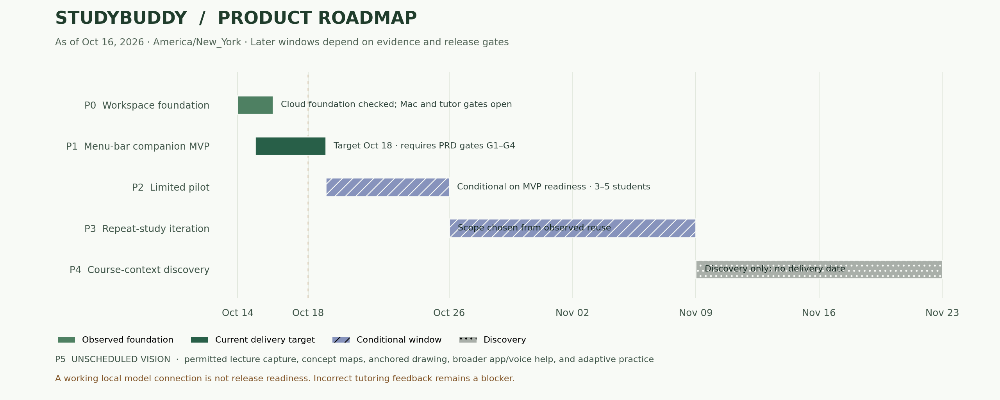

# Product roadmap

Version 0.2 · October 16, 2026 · [Product baseline](README.md) · [PRD release gates](prd.md#6-release-gates)

The sequence is **menu-bar companion with a reliable study session → evidence of repeat use → deeper course support → broader companion experience**. October 18 is the founder MVP target. Later windows are planning hypotheses, conditional on evidence and active work; they are not promised launches or scheduled background execution. Dates use America/New_York.

[Vector version for sharing](roadmap-timeline.svg)

The static chart can be regenerated with `python3 docs/product/render_roadmap.py` in an environment with Matplotlib. It is a documentation tool, not a new application dependency; update the chart data and phase table together when dates change.

## Phase sequence and decision gates

| Phase / window | Strategic goal | Work and requirement connection | Exit / next decision | Status and owner |
| --- | --- | --- | --- | --- |
| P0 — Foundation, Oct 14–15 | Make the core study workspace usable | PDF import/navigation, saved per-slide work, deterministic lab, free local runtime; FR-01/02/03/08/09/10 | Maintain passing software checks; separate live model quality from connection health | Workspace foundation observed; Mac and tutor quality still open. Codex implementation |
| P1 — Founder MVP, Oct 15–18 target | Follow a lecture from the menu bar on the target Mac | Build menu-bar activation, floating panel, study-mode activation and active-window following and saved-slide restoration; resolve tutor errors and complete Mac setup/restart/offline checks; FR-01 through FR-14 | PRD G1–G4 pass. If they fail, retain alpha status and replan explicitly | In progress; native integration and quality gates open. Codex implementation/evidence; founder Mac run and release decision |
| P2 — Limited pilot, Oct 19–25 tentative | Learn whether the workflow is preferable to existing tools | Three observed sessions; expand toward five; compare usual ChatGPT workflow and log errors, copying steps, useful help, and return behavior; MRD N1–N5 | G5 permits entry. Use MRD activation/return targets for a directional decision; do not expand with critical errors | Conditional. Founder recruits; Codex fixes observed problems during active work |
| P3 — Repeat-study iteration, Oct 26–Nov 8 tentative | Make a second real study session worthwhile | Prioritize the strongest observed obstacle: resume/navigation improvements, clearer explanations, or saved practice history. A practice history is not a validated mastery model | Evidence of independent return and a specific unmet need; map any new feature to a new PRD requirement before building | Uncommitted scope. Founder prioritizes using pilot observations |
| P4 — Course-context expansion, discovery from Nov 9 | Reduce missing course context when it is a demonstrated blocker | Evaluate additional assignment/note sources and one capture/connection option. Lecture transcription, Drive, and Outlook are alternatives to investigate, not an automatic bundle | Select one option only with user need, a free/open-source implementation path, data-control design, and testable acceptance criteria | Discovery only; no delivery date or integration purchase |
| P5 — Broader companion, unscheduled | Support the full lecture → study → practice cycle | Permission-based lecture capture; organized notes/concept maps; drawings anchored over external app content, broader app support, voice, and longer-term practice adaptation | Reliability, repeated use, clear user control, and operating-system feasibility established for each capability | Long-term vision. No release date or committed feature order |

## This week's execution checkpoints

- **Thursday, Oct 15:** keep the working foundation; establish this product baseline; retain real-model failures as open issues.
- **Friday, Oct 16:** correct the MVP to a native menu-bar companion, build window following, and retain answer quality and actual Mac checks as required gates. Use the same reference cases when comparing models.
- **Saturday, Oct 17:** complete the founder study journey and fix failures. Classmate sessions can begin early only if G1–G5 permit them; recruitment can happen beforehand.
- **Sunday, Oct 18:** release the usable founder MVP only if G1–G4 pass. Otherwise report the open gates and a revised delivery decision. The existing PDF workspace is supporting infrastructure and does not satisfy the integration MVP.

The [week checklist](../mvp-release-plan.md) tracks execution; the PRD defines completion. The [validation record](../validation.md) is evidence, not the roadmap. None should claim a future checkpoint has happened.

## Scope-change rule

When a new idea arrives, record its student need, evidence, cost/license implications, proposed acceptance check, and which current task would be displaced. Keep unvalidated ideas in P3–P5 discovery. Current correctness and saved-work failures take precedence over feature expansion. The founder can change priorities explicitly; update the PRD, this roadmap, and the baseline change log together.

No billing, paid infrastructure, public multi-user hosting, or new platform commitment is included. “Free resources” does not authorize a free trial that later becomes a paid dependency.
